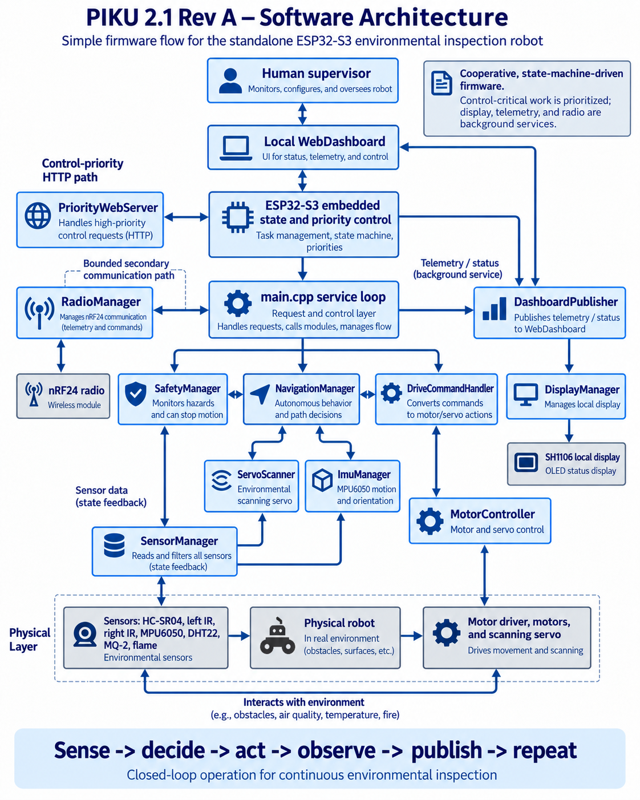
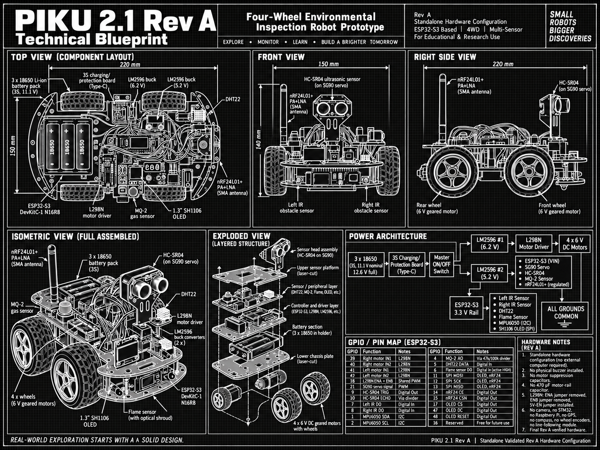
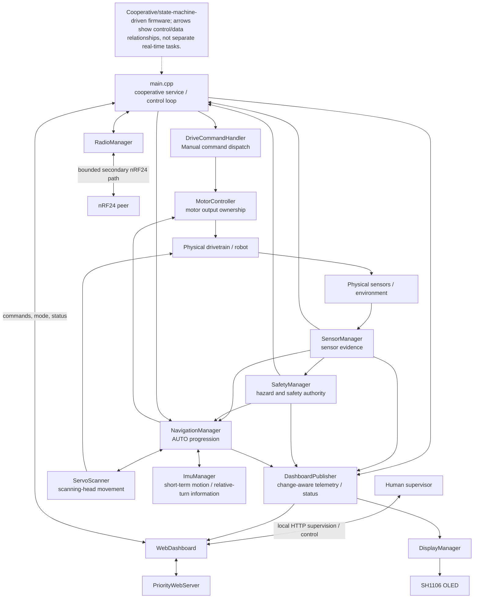
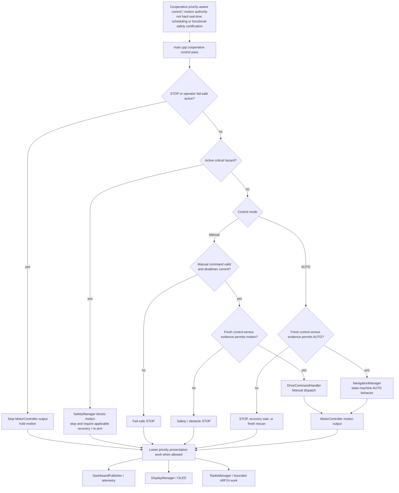
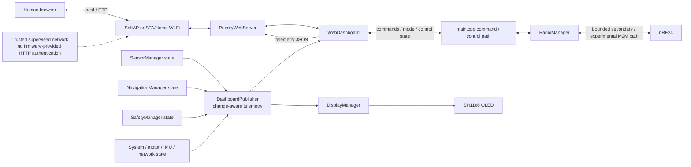

# PIKU 2.1 Rev A — Advanced Firmware

Advanced ESP32-S3 firmware for the PIKU 2.1 Rev A cyber-physical environmental inspection robot, featuring responsive Manual control, autonomous navigation, MPU6050-assisted 35-degree spin-based obstacle avoidance, low-mounted IR and servo-mounted ultrasonic sensing, environmental hazard monitoring, SoftAP/STA Wi-Fi operation, real-time telemetry, and safety-oriented recovery logic.

## New to PIKU?

PIKU is a long-term Intelligent Robotics and Cyber-Physical Systems research platform. This repository contains the validated standalone firmware for the PIKU 2.1 Rev A robot. This stage focuses on making the robot independently reliable before deeper CPS integration. A later Stage 4 repository connects this robot foundation with other CPS nodes.

For a beginner-friendly walkthrough of the firmware, see [Software Explanation](SOFTWARE_EXPLANATION.md).

## Project overview

PIKU 2.1 Rev A is a standalone four-wheel mobile research prototype built around an ESP32-S3. It combines locomotion, multi-zone obstacle sensing, environmental monitoring, browser-based operation, local safety decisions, and autonomous recovery in one firmware project.

The frozen firmware supports supervised research, education, and prototype demonstrations. It is not production or industrial safety equipment.

## Research context

PIKU is being developed as a cyber-physical environmental inspection robotics research platform. Rev A investigates how a compact mobile robot can combine:

- environmental sensing and local hazard response;
- responsive browser-based Manual control;
- autonomous obstacle recovery;
- low-body IR and higher servo-mounted ultrasonic sensing;
- Wi-Fi telemetry and control; and
- short-term MPU-assisted relative rotation.

Rev A does not provide mapping, SLAM, absolute localization, compass heading, or wheel odometry.

## Architecture at a Glance

This figure is a high-level visual summary of the frozen standalone Rev A software architecture. It complements, rather than replaces, the implementation-grounded documentation below.

### Technical Blueprint

The black technical blueprint provides a compact engineering overview of the Rev A prototype and its supporting architecture.

## Position in the PIKU Research Roadmap

PIKU is being developed through multiple robot and CPS stages rather than as one single finished robot.

| Stage | Role |
| --- | --- |
| PIKU V1 | Early Arduino-based mobile robotics foundation |
| PIKU V2.0 | First major ESP32 environmental inspection robot |
| PIKU V2.0.1 | More mature ESP32 robot with improved sensing, dashboard, and autonomous behavior |
| PIKU 2.1 Rev A | Current validated standalone ESP32-S3 robot — **this repository** |
| PIKU 2.1 Rev A Stage 4 CPS Integration | Later stage that migrates PIKU 2.1 into the multi-node CPS architecture |
| CPS Node V1 | Fixed environmental sensing/coordinator node |
| PIKU 2.0.1 + PIKU 2.1 + CPS Node V1 | Multi-node integrated CPS research platform |
| Future PIKU / CPS stages | Planned research into localization, mapping, ROS 2, edge intelligence, and more advanced coordination |

    PIKU V1
      → PIKU V2.0
      → PIKU V2.0.1
      → PIKU 2.1 Rev A
      → Stage 4 CPS Integration
      → Multi-node CPS Platform

This repository is not the final multi-node CPS. It is the validated standalone PIKU 2.1 Rev A firmware foundation. That standalone foundation is later migrated into PIKU 2.1 Rev A Stage 4 CPS Integration, where PIKU 2.1 operates as a CPS-connected mobile agent alongside CPS Node V1 and PIKU 2.0.1. Stage 4 behavior and the future capabilities listed above are not implemented claims for this repository.

## Key capabilities

- Manual forward, reverse, left, right, STOP, Pivot, and Spin control
- Configurable drive speed with pointer-release and deadman protections
- Unified non-blocking AUTO obstacle recovery
- 170/90/10-degree servo scan with multiple HC-SR04 samples per direction
- Independent low front-left and front-right reflective IR obstacle zones
- MPU6050 gyro-Z-assisted 35-degree relative SPIN control
- Autonomous stopped retry when no safe escape path is available
- DHT22, MQ-2, and digital flame monitoring
- Two-second continuously-clear environmental-hazard recovery
- Responsive dashboard, telemetry, AUTO diagnostics, and safety state
- Standalone SoftAP and provisioned STA/Home Wi-Fi operation
- Secondary nRF24 heartbeat/experimental machine-to-machine path
- SPI SH1106 OLED status display

## Hardware platform

| Area | Frozen Rev A hardware |
| --- | --- |
| Controller | ESP32-S3 DevKitC-1 N16R8 |
| Chassis | 4WD mobile chassis |
| Motor driver | L298N with shared ENA/ENB PWM |
| Scan actuator | SG90 servo |
| Primary ranging | Servo-mounted HC-SR04 with echo voltage divider |
| Low obstacle zones | Separate left and right reflective IR modules |
| Inertial sensor | MPU6050 over I2C |
| Environment | DHT22, MQ-2 analog module, digital flame module |
| Display | SH1106 SPI OLED |
| Communication | ESP32-S3 Wi-Fi and nRF24 |
| Power used in final test | Rechargeable 18650 battery system |

The flame module is powered from 3.3 V. Its DO output is connected to GPIO6, AO is disconnected, active polarity is HIGH, and a small black optical shroud is installed in the final tested hardware.

## Pin mapping

| Function | GPIO |
| --- | ---: |
| Right motor IN1 / IN2 | 39 / 40 |
| Left motor IN3 / IN4 | 41 / 42 |
| L298N ENA + ENB shared PWM | 18 |
| SG90 servo | 21 |
| HC-SR04 TRIG / divided ECHO | 9 / 10 |
| Left IR / Right IR | 7 / 8 |
| MPU6050 SDA / SCL | 1 / 2 |
| MQ-2 analog | 4 |
| DHT22 data | 5 |
| Flame digital DO | 6 |
| SPI MOSI / SCK / MISO | 11 / 12 / 13 |
| nRF24 CE / CSN | 14 / 15 |
| OLED CS / DC / RST | 17 / 47 / 48 |
| Reserved/free | 16 |

The SH1106 OLED and nRF24 share the MOSI/SCK SPI bus. The frozen pin map contains 24 unique nonnegative assignments; GPIO16 remains intentionally unallocated.

## Firmware architecture

| Component | Responsibility |
| --- | --- |
| main.cpp | Setup, priority service loop, mode transitions, Manual coordination |
| NavigationManager | Non-blocking AUTO navigation, scan, spin, retry, and recovery states |
| MotorController | L298N direction and PWM ownership |
| DriveCommandHandler | Manual command validation and Pivot/Spin dispatch |
| SensorManager | Scheduled sensor acquisition and coherent snapshots |
| SafetyManager | Hazard classification and motion authority |
| ServoScanner | Physical LEFT/FRONT/RIGHT head positioning |
| ImuManager | MPU6050 sampling, health, and motion state |
| WebDashboard | SoftAP/STA networking, HTTP endpoints, commands, and telemetry JSON |
| DashboardPublisher | Change-aware telemetry publication |
| PriorityWebServer | Control-priority HTTP request handling |
| RadioManager | Bounded nRF24 heartbeat and receive handling |
| DisplayManager | Local OLED telemetry and warnings |

The auditable Mermaid sources for this architecture and the control, recovery, and communication views are in [`architecture_source/`](architecture_source/).

Control and safety work remain ahead of slower display, environmental, and radio tasks. Navigation is timestamp/state driven so HTTP, STOP, mode changes, sensing, telemetry, and Manual deadman handling continue between maneuver steps.

## Manual mode

Manual mode provides Forward, Backward, Left, Right, and STOP commands with selectable Pivot or Spin turning and configurable speed.

- Pivot energizes only the outside side for a directional turn.
- Spin drives the left and right sides in opposite directions.
- Holding a movement control refreshes the command every 250 ms.
- The firmware stops Manual movement after 750 ms without a valid refresh.
- Pointer/touch release, cancellation, visibility loss, page exit, STOP, mode changes, and safety events preserve explicit stop behavior.
- Forward commands remain subject to fresh front-ultrasonic safety checks.

The browser controls were physically observed as practically responsive. No instrumented latency distribution was collected.

## Autonomous navigation

The physically validated ordinary-obstacle flow is:

    obstacle detected
      -> STOP
      -> short controlled reverse
      -> settle
      -> fresh LEFT / FRONT / RIGHT scan
      -> select a safe side
      -> approximately 35-degree SPIN
      -> STOP and fresh obstacle re-evaluation
      -> continue AUTO or retry safely

Ordinary obstacle confusion no longer permanently abandons AUTO. After bounded active attempts, the robot remains stopped in a non-blocking retry state and periodically rescans. User STOP, leaving AUTO, an active environmental hazard, and serious sensor fault/stale evidence retain higher safety authority.

```mermaid
stateDiagram-v2
    [*] --> AutoForward
    AutoForward --> ObstacleStop: obstacle evidence
    ObstacleStop --> ReversePreparation: motors stopped
    ReversePreparation --> Reverse: preparation complete
    Reverse --> ReverseSettle: bounded reverse complete
    ReverseSettle --> FreshScan: settled
    FreshScan --> Recenter: fresh LEFT / FRONT / RIGHT evidence
    Recenter --> ChooseSaferDirection: head centered
    ChooseSaferDirection --> RelativeTurn: safe side available
    ChooseSaferDirection --> AutoForward: environmental recovery; front is safest
    ChooseSaferDirection --> BlockedRetry: no safe side
    BlockedRetry --> FreshScan: stopped rescan / retry
    RelativeTurn --> PostTurnStop: gyro-assisted relative turn complete
    PostTurnStop --> FreshReevaluation: settled
    FreshReevaluation --> AutoForward: safe to continue AUTO
    FreshReevaluation --> ObstacleStop: obstacle remains

    AutoForward --> EnvironmentalHazard: recoverable environmental hazard active
    ObstacleStop --> EnvironmentalHazard: recoverable environmental hazard active
    RelativeTurn --> EnvironmentalHazard: recoverable environmental hazard active
    EnvironmentalHazard --> HazardClearWait: hazard clears
    HazardClearWait --> EnvironmentalHazard: hazard returns
    HazardClearWait --> FreshScan: continuously clear; fresh recovery scan

    AutoForward --> OperatorAbort: operator STOP / mode change
    ObstacleStop --> OperatorAbort: operator STOP / mode change
    BlockedRetry --> OperatorAbort: operator STOP / mode change
    HazardClearWait --> OperatorAbort: operator STOP / mode change

    AutoForward --> CriticalAbort: nonrecoverable critical hazard
    ObstacleStop --> CriticalAbort: nonrecoverable critical hazard
    RelativeTurn --> CriticalAbort: nonrecoverable critical hazard
    EnvironmentalHazard --> CriticalAbort: nonrecoverable critical hazard

    OperatorAbort --> [*]
    CriticalAbort --> [*]
```

## Multi-zone obstacle avoidance

The obstacle sensors cover different physical zones:

- LEFT IR on GPIO7 covers the low front-left body zone and gives a RIGHT escape preference.
- RIGHT IR on GPIO8 covers the low front-right body zone and gives a LEFT escape preference.
- BOTH IR triggers reverse, fresh scanning, and selection of the safest valid side.
- The servo-mounted HC-SR04 covers the higher front/scanning zone and uses the same unified recovery sequence for a front obstacle.

Fresh evidence can override a directional preference when the preferred side is unsafe. A clear HC-SR04 result cannot cancel valid IR evidence, and clear IR inputs cannot cancel a valid HC-SR04 obstacle.

## Scan and servo behavior

| Physical view | Servo command | Approximate logical view |
| --- | ---: | ---: |
| LEFT | 170 degrees | -80 degrees |
| FRONT | 90 degrees | 0 degrees |
| RIGHT | 10 degrees | +80 degrees |

The scan is non-blocking and collects three ultrasonic readings per direction after configurable servo settling. Coherent finite readings are aggregated conservatively. CLEAR_NO_ECHO is a valid clear/out-of-range condition and remains distinct from SENSOR_FAULT or stale evidence. The geometry is not a calibrated angular field-of-view measurement.

## MPU6050 relative-turn logic

AUTO uses the same MotorController spinLeft and spinRight primitives used by Manual SPIN. At each AUTO spin:

1. the relative-angle accumulator is reset;
2. a fresh stopped gyro-Z sample supplies short-term bias;
3. fresh angular-rate samples are integrated with a deadband;
4. the spin stops around the configured 35-degree relative target; and
5. timed fallback and a hard maximum timeout remain available if IMU data becomes unusable.

Repeated final physical tests produced approximately 30-35-degree AUTO spins. This is short-term relative rotation only—not compass heading, absolute yaw, localization, odometry, or SLAM.

## Environmental monitoring

- **DHT22:** temperature and humidity telemetry with warning/critical classification.
- **MQ-2:** filtered analog gas/smoke/combustible-gas indication with warm-up state and relative alarm thresholds.
- **Flame module:** digital comparator output on GPIO6, powered at 3.3 V, AO disconnected, active HIGH, with detection/clear persistence.

Physical tests showed increasing MQ-2 raw values near released lighter gas, but the system is uncalibrated and makes no ppm claim.

The black optical shroud remained installed for the final flame test. No false alarms were observed during that approximately 30-minute session, but earlier unshielded tests showed sunlight and object-related optical false triggering. The module is not a calibrated or certified fire detector.

## Hazard response and AUTO recovery

Environmental hazard behavior is:

    hazard active
      -> immediate STOP and dashboard alarm
      -> remain stopped while hazard persists

    hazard clears
      -> require approximately 2 seconds continuously clear
      -> reset the timer if the hazard returns
      -> fresh LEFT / FRONT / RIGHT scan
      -> choose a safe path
      -> resume AUTO

This automatic clear-wait/scan/resume behavior was physically observed working. Temperature-critical and other nonrecoverable safety conditions retain stop/re-arm authority.

## Web dashboard

The ESP32-S3 serves a responsive embedded dashboard without an external application server. It provides:

- Manual mode, turn-mode selection, speed, and STOP controls;
- AUTO mode selection and current navigation decisions;
- live obstacle, environment, IMU, network, radio, and system telemetry;
- preferred/selected path, relative spin, scan, blocked-retry, stuck, and hazard diagnostics;
- SoftAP and STA provisioning/status; and
- compact OLED-aligned safety information.

Telemetry publication is change-aware and rate bounded. The interface prioritizes movement/STOP handling over background presentation work.

## Communication architecture

Interactive control uses local HTTP over ESP32-S3 Wi-Fi. A priority request path handles control traffic ahead of normal telemetry and auxiliary work. The dashboard refresh/deadman design limits how long a lost browser or network path can leave a Manual command active.

The firmware does not provide transport authentication or encryption beyond the surrounding Wi-Fi network. Operate it only on trusted, supervised networks.

## SoftAP and STA Wi-Fi

Two operational paths are supported:

1. **Standalone SoftAP:** direct local connection to PIKU without an external router; also serves as the recovery/fallback access path.
2. **STA/Home Wi-Fi:** PIKU connects to a provisioned 2.4 GHz network and serves the dashboard through that network while retaining SoftAP availability.

Both paths were physically tested successfully. The final STA session showed stable practical operation within approximately 30 ft/about 9 m in the tested environment, with good qualitative responsiveness and telemetry. This is not guaranteed RF coverage or formal range characterization.

## nRF24 role

The nRF24 is a secondary, bounded communication path for heartbeat/status exchange and future experimental machine-to-machine integration. It is not the primary interactive control channel, and peer reachability is not required for dashboard operation. Its protocol and hardware state are exposed through telemetry.

## Physical validation summary

| Area | Final evidence |
| --- | --- |
| Continuous final test | Approximately 30 minutes from fully charged 18650 batteries |
| Useful battery period | Control, telemetry, sensing, and AUTO remained functional; low power later caused robot/network disconnect |
| Final network | STA/Home Wi-Fi |
| Practical tested STA radius | Approximately 30 ft/about 9 m in the tested environment |
| SoftAP | Earlier standalone SoftAP operation physically validated |
| AUTO navigation | Unified obstacle recovery aggressively stress-tested; previous ordinary-obstacle permanent latch not reproduced |
| Relative spin | 35-degree configured target; approximately 30-35 degrees physically observed |
| Reflective IR | Representative obstacles detected around approximately 7 cm in the tested setup |
| Black IR targets | Not reliably detected |
| Environment | Flame, MQ-2, and temperature paths worked |
| Flame false alarms | None observed in the final shrouded 30-minute session |
| Hazard recovery | Approximately two-second continuously-clear recovery worked |
| Responsiveness | Control and telemetry remained qualitatively responsive |

All distances, durations, angular results, range, and responsiveness statements above are prototype observations unless explicitly identified as configuration. They are not calibrated performance specifications.

## Configured HC-SR04 thresholds

These are software configuration values, not physically calibrated range limits:

| Constant | Value | Purpose |
| --- | ---: | --- |
| AUTO_OBSTACLE_CM | 20.0 cm | Trustworthy front AUTO readings at or below this value initiate avoidance |
| OBSTACLE_CM | 25 cm | General obstacle/caution threshold |
| NEAR_OBSTACLE_CM | 7 cm | Separate near-obstacle safety threshold |
| MANUAL_FORWARD_STOP_CM | 25 cm | Manual forward stop threshold |
| MANUAL_FORWARD_CLEAR_CM | 30 cm | Manual forward clear hysteresis threshold |

The final physical test did not instrument HC-SR04 detection exactly at 20 cm.

## Known limitations

- Approximately 30 minutes of useful runtime was observed in the final battery test; no voltage/current endurance curve was instrumented.
- Reflective IR sensors can miss dark or black targets and remain surface/geometry/light dependent.
- The low-cost flame module remains optically and environmentally sensitive despite improvement from the shroud.
- MQ-2 output is qualitative/relative and uncalibrated; it is not ppm.
- RF coverage and interference behavior have not been formally characterized.
- Control responsiveness was observed qualitatively; no instrumented latency distribution was collected.
- There are no wheel encoders, wheel odometry, absolute localization, mapping, or SLAM.
- The dashboard uses unauthenticated HTTP and is intended only for trusted supervised networks.
- The prototype has no production, industrial-safety, calibrated fire-detection, or calibrated gas-detection certification.

## Build environment and requirements

- PlatformIO Core or PlatformIO IDE
- Environment: **esp32-s3-n16r8**
- Board definition: **esp32-s3-devkitc-1**
- Arduino framework for ESP32
- 16 MB flash configuration with OPI PSRAM support
- USB data cable and the correct ESP32-S3 serial port
- Pinned libraries declared in platformio.ini

Final clean verification:

| Result | Usage |
| --- | ---: |
| Build | PASS, zero unexpected compiler warnings |
| RAM | 53,524 / 327,680 bytes (16.3%) |
| Flash | 1,009,317 / 6,553,600 bytes (15.4%) |

## Build and upload instructions

From the repository root:

    pio run -e esp32-s3-n16r8

Clean verification:

    pio run -e esp32-s3-n16r8 -t clean
    pio run -e esp32-s3-n16r8

Upload only with the correct ESP32-S3 board and serial port selected, the chassis secured, wheels safely clear, and an accessible power cutoff:

    pio run -e esp32-s3-n16r8 -t upload

Serial monitor:

    pio device monitor -b 115200

The private repository intentionally tracks the deployment configuration header required by this unit, so an authorized private clone preserves the intended runnable configuration. Never print its values in logs or public documentation.

## Repository structure

    .
    |-- include/
    |   |-- PinConfig.h
    |   |-- RobotConfig.h
    |   |-- Secrets.h
    |   +-- subsystem interfaces
    |-- src/
    |   +-- firmware and embedded dashboard implementation
    |-- docs/
    |   |-- PIKU_2.1_REV_A_TESTING.md
    |   |-- COMMUNICATION_LATENCY_AUDIT.md
    |   +-- stage and historical testing records
    |-- architecture_source/
    |   +-- auditable Mermaid diagram sources
    |-- figures/
    |   +-- architecture/
    |       +-- finalized architecture PNGs
    |-- platformio.ini
    |-- SOFTWARE_EXPLANATION.md
    |-- README.md
    +-- .gitignore

Generated PlatformIO build output is not source-controlled.

## Testing documentation

The primary evidence record is [PIKU 2.1 Rev A Physical Testing Record](docs/PIKU_2.1_REV_A_TESTING.md). It preserves historical observations, build-verification boundaries, the 2026-09-10 final physical validation, and the remaining prototype limitations.

Additional records:

- [Communication Latency Audit](docs/COMMUNICATION_LATENCY_AUDIT.md)
- [Stage 1 record](docs/PIKU_2_1_REV_A_STAGE1.md)
- [Stage 2 record](docs/PIKU_2_1_REV_A_STAGE2.md)
- [Historical testing notes](docs/TESTING.md)

## Final frozen version

- Commit: **8f6f2dc9a9aa507493003fda701efd953d3b13cd**
- Annotated tag: **v2.1-revA-final**
- Firmware version: **2.1.0-revA-stage2**
- Status: **Physically validated functional research prototype**
- Development state: **Standalone Rev A frozen**

Further standalone Rev A feature expansion is intentionally stopped. Future improvements should occur in later revisions or CPS integration stages rather than modifying this frozen baseline.

## Private repository notice

**This repository is intended to remain PRIVATE.**

It contains deployment-specific configuration and credentials required for complete firmware reproduction. Do not expose the repository or those credentials publicly, copy secret values into documentation, or publish generated logs containing them. Review access controls before adding collaborators, automation, mirrors, archives, or public release artifacts.

Recommended private GitHub repository name:

**PIKU-2.1-Rev-A-Advanced-Firmware**

Recommended GitHub description:

Advanced ESP32-S3 firmware for the PIKU 2.1 Rev A cyber-physical environmental inspection robot, featuring responsive Manual and autonomous navigation, MPU6050-assisted spin-based obstacle avoidance, multi-zone IR and ultrasonic sensing, environmental hazard monitoring, SoftAP/STA Wi-Fi control, telemetry, and safety-oriented recovery logic.

## Author and research role

**Md Habibur Rahman Habib** 
Research Assistant 
First Author and Chief Robotics Engineer 

PIKU is being developed as a cyber-physical environmental inspection robotics research platform.
